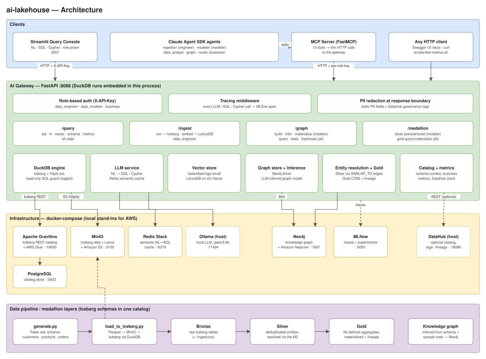

# ai-lakehouse

A local, laptop-sized prototype of an **AI-native data lakehouse**. It combines an Iceberg lakehouse, a knowledge graph, vector search, and LLM-powered querying behind one role-secured API, which Claude agents drive through MCP.

Every component is an open-source stand-in for a managed AWS service, so the same design maps onto a cloud deployment:

| Local (this repo) | AWS equivalent |
|---|---|
| MinIO | Amazon S3 |
| Apache Gravitino (Iceberg REST catalog) + PostgreSQL | AWS Glue Data Catalog |
| DuckDB (embedded in the gateway) | Amazon Athena |
| Neo4j | Amazon Neptune |
| Ollama | Amazon Bedrock |

## Architecture



> The diagram is a draw.io file. Open [`docs/architecture.drawio`](docs/architecture.drawio) (or the `.svg`, which embeds the same model) in [app.diagrams.net](https://app.diagrams.net) or the draw.io desktop app to edit it.

### How a request flows

1. **Clients** call the gateway over HTTP with an `X-API-Key`. Clients include the Streamlit console, the Claude agents (through the MCP server), and plain HTTP tools.
2. The **AI Gateway** (FastAPI) maps the key to a role and checks it against the route. It traces the call to MLflow and redacts PII in the response.
3. **Services** inside the gateway do the work:
   - DuckDB queries Iceberg tables through Gravitino and MinIO.
   - The LLM service turns natural language into SQL or Cypher, with a Redis semantic cache.
   - LanceDB handles vector search.
   - Neo4j holds the knowledge graph.

### Roles

| Role | Can reach |
|---|---|
| `data_engineer` | `/ingest/*` and every read route |
| `data_modeler` | `/graph/build`, `/graph/infer*`, `/medallion/silver/*`, Gold materialization, and every read route |
| `business` | Read routes only: `/query/*`, `/graph/query`, `/graph/stats`, `/graph/freshness`, `/medallion/gold` (query only) |

### Medallion layers

- **Bronze**: raw Iceberg tables, loaded by `data_generator/load_to_iceberg.py` or `/ingest/csv`.
- **Silver**: deduplicated entities. Candidate rows are loaded into Neo4j and linked with scored `SIMILAR_TO` edges, then grouped into canonical records.
- **Gold**: aggregates defined in natural language. The LLM only writes a `SELECT`, which passes a read-only guard. The application wraps it in `CREATE TABLE … AS` in the `gold` schema and registers lineage.

## Repository layout

```
gateway/          FastAPI AI gateway (routers, auth, PII redaction, tracing, services)
mcp_server/       MCP server exposing the gateway as 15 tools
agents/           Claude Agent SDK agents: ingestion, modeler, data_analyst, graph, router
streamlit_app/    Query console (NL / SQL / Cypher)
data_generator/   Synthetic e-commerce star schema + Iceberg loader
sample_data/      Small CSVs for ingestion demos
scripts/          MinIO / Gravitino init, metrics smoke test
mlflow/           MLflow tracking server image
docs/             Architecture diagram (draw.io + SVG) and its generator
```

## Quick start

**Prerequisites:** Docker (Docker Desktop or Colima), Python 3.11, [`uv`](https://github.com/astral-sh/uv), and [Ollama](https://ollama.com) running on the host.

```bash
# 1. Configure secrets
cp .env.example .env
# fill in passwords and generate the three API keys:
python3 -c "import secrets; print(secrets.token_hex(32))"

# 2. Pull the local LLM
ollama pull qwen3:4b

# 3. Build the gateway image and start the stack
docker build -t lh-gateway:latest ./gateway
docker-compose up -d

# 4. Generate and load sample data into Iceberg
cd data_generator
uv venv --python 3.11 .venv && uv pip install --python .venv/bin/python -r requirements.txt
.venv/bin/python generate.py
.venv/bin/python load_to_iceberg.py --schema ecommerce --gravitino-uri http://localhost:19090
```

> **Ollama host address:** `docker-compose.yml` points the gateway at `http://192.168.5.2:11434`, which is the macOS host as seen from Colima. On Docker Desktop, change `OLLAMA_BASE_URL` to `http://host.docker.internal:11434`.

### Endpoints

| Service | URL |
|---|---|
| Gateway API docs | http://localhost:8088/docs |
| Health / readiness | http://localhost:8088/health, http://localhost:8088/ready |
| Query console | http://localhost:8501 |
| MLflow traces | http://localhost:5050 |
| Neo4j browser | http://localhost:7474 |
| MinIO console | http://localhost:9101 |
| Gravitino | http://localhost:19090 |

### Running the agents

The agents use the [Claude Agent SDK](https://docs.claude.com/en/api/agent-sdk/overview), and each one launches the MCP server over stdio.

```bash
# one-time: venvs for the MCP server and the agents
(cd mcp_server && uv venv --python 3.11 .venv && uv pip install --python .venv/bin/python -r requirements.txt)
(cd agents && uv venv --python 3.11 .venv && uv pip install --python .venv/bin/python -r requirements.txt)

cd agents
export API_KEY_BUSINESS=$(grep API_KEY_BUSINESS ../.env | cut -d= -f2)
.venv/bin/python router_agent.py "Which product category has the highest average price?"
.venv/bin/python router_agent.py "What else did customers who bought Wireless Noise-Cancelling Headphones also buy?"
```

| Agent | Role | Purpose |
|---|---|---|
| `ingestion_agent.py` | data_engineer | Land CSVs into Iceberg, embed text columns |
| `modeler_agent.py` | data_modeler | Infer, preview, and materialize the knowledge-graph model |
| `data_analyst_agent.py` | business | Schema discovery, NL→SQL, SQL, vector search |
| `graph_agent.py` | business | Read-only relationship questions over Neo4j |
| `router_agent.py` | business | One entry point that picks SQL or graph tools |

### Optional: DataHub

If a DataHub GMS is reachable at `http://host.docker.internal:18080`, the gateway uses its descriptions and tags. They enrich NL→SQL prompts and drive column masking. Without DataHub, those features fall back to built-in defaults.

## Regenerating the diagram

`docs/architecture.drawio` and `docs/architecture.svg` are both produced from `docs/gen_diagram.py`:

```bash
python3 docs/gen_diagram.py docs
```

You can also edit the `.drawio` file directly in draw.io and export it as SVG.

## Status

This is a prototype for exploring the architecture, not a production system. Auth is static per-role API keys, and the compose stack is tuned for local development, with hot reload and default ports.
