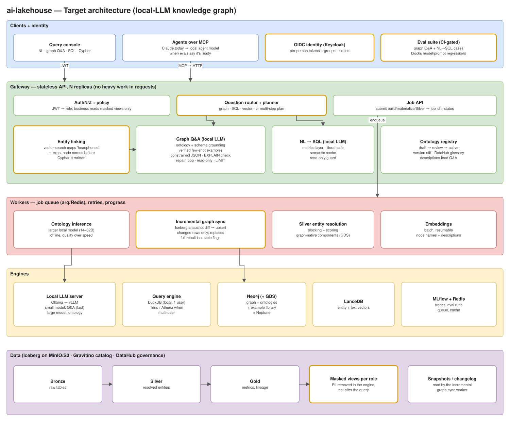

# Architecture proposal: a local LLM that builds the ontology and answers from the knowledge graph

**Goal.** A local model (no frontier API, no data leaving the machine) should:

1. infer the knowledge-graph ontology from lakehouse tables, and
2. answer complex, multi-hop business questions from the resulting graph.

This document records what was fixed in the current system, what was built toward that goal, and the proposed target architecture. Each step in the target is gated by an evaluation, not by intuition.

*Orange boxes are new components. Edit the diagram in [`architecture-target.drawio`](architecture-target.drawio), or regenerate both diagrams with `python3 docs/gen_diagram.py docs`.*

---

## 1. Design principle: structure around the model, not just a bigger model

Small local models fail at ontology and Cypher work in predictable ways:
- invented labels and properties
- reversed relationship directions
- broken JSON
- ignoring which dataset to query
- prose wrapped around the query

Each of these failures can be caught mechanically, so the system catches them instead of hoping the model avoids them. A bigger model still helps for ontology inference, which runs offline and favors quality over speed. The structure is what makes a 4–8B model usable for interactive Q&A.

## 2. What was fixed in this round

| Area | Problem | Fix |
|---|---|---|
| Concurrency | One global lock on one DuckDB connection serialized every query. `async` routes ran blocking DuckDB and Neo4j work on the event loop, so one slow call froze the gateway. | Per-request cursors, with concurrent reads capped by `DUCKDB_MAX_CONCURRENT_QUERIES` and serialized writes. Blocking work runs in the threadpool. |
| Silent truncation | `execute()` capped every read at 1,000 rows. Silver silently dropped rows past 1,000, `/ingest/embed` embedded at most 1,000, and callers were never told. | Responses carry `truncated: true`. Internal pipelines use the uncapped `read_all()`. |
| Semantic cache | "revenue in 2024" hit the cached SQL for "revenue in 2023" (near-identical embeddings). The same happened for top vs. bottom and Germany vs. France. | A cache hit must also match a literal signature: numbers, quoted values, proper nouns, sort direction, negation. |
| PII | `SELECT first_name AS x`, `concat(...)`, and `RETURN c.first_name` (dotted key) all bypassed redaction. `RETURN c` returned the whole unredacted node. `/medallion/gold` didn't redact at all. | Query-lineage tracing (aliases, CTEs, unions, WITH chains), recursive redaction of nested values, and Gold redaction. |
| Ontology review | `/graph/infer/materialize` re-ran inference, so the committed model could differ from the one reviewed. | Versioned ontology drafts in Neo4j. Materialize commits exactly the reviewed version. |
| Ontology output | Free-text JSON parsing failed on wrong shapes. | Ollama structured outputs, constrained to a JSON schema. |
| Entity resolution | O(n²) pairwise comparison, one Neo4j round trip per row, and stale edges from earlier runs merging groups. Silver rebuilds appended duplicate rows. | Blocking (email, name prefix and suffix), batched `UNWIND` writes, staging rebuilt per run, and Silver replaced on rebuild. |
| Graph staleness | Nothing marked the graph out of date after new data landed. | Gateway writes are logged per schema. `/graph/freshness` returns `stale`. |
| Injection | Caller-supplied schema and table names went straight into DDL. | Identifier validation on every interpolated name. |
| Identity and CORS | Only three shared keys, and CORS allowed all origins (`*`). | Optional named per-person keys (principal recorded on every trace) and an explicit CORS allowlist. |
| Dev vs. run config | `--reload` and source mounts were in the base compose file, and the Ollama address was hard-coded to Colima. | Dev settings moved to `docker-compose.override.yml`. `OLLAMA_BASE_URL` is set from `.env`. |
| Tests | None. | 63 unit and route tests, which need no services running. |

## 3. Built toward the goal: local-LLM graph Q&A (`POST /graph/nl`)

`services/graph_qa.py` runs this pipeline:

1. **Grounding.** The prompt includes:
   - the live graph schema, with relationship direction checked against the data
   - the active ontology's business descriptions
   - the most similar verified question→Cypher examples, retrieved by embedding
2. **Constrained output.** The model returns `{"reasoning", "cypher"}` as JSON, so nothing has to be scraped out of prose.
3. **Validation.** The query must pass a read-only clause check, must not use internal labels, and must stay within the requested schema. Neo4j `EXPLAIN` then plans it without running it and flags unknown labels, relationship types and properties.
4. **Repair loop.** Problems, including an empty result, go back to the model, for up to `GRAPH_NL_MAX_ATTEMPTS` attempts.
5. **Bounded execution.** A `LIMIT` is enforced, and the query runs in a read transaction, which Neo4j itself enforces.
6. **Answer.** The written answer is produced only from rows that have already been redacted.

**Supporting pieces:**
- `POST /graph/nl/examples` (data_modeler): adds a verified question→Cypher pair to the few-shot library. This is how the model improves on *this* graph without fine-tuning.
- `GET /graph/ontology`: returns the active ontology and its version history.
- `scripts/eval_graph_nl.py`: an accuracy harness that compares `/graph/nl` results with reference Cypher.
- MCP tools `ask_graph_nl` and `add_graph_example`, and a "Graph question" tab in the console.

## 4. Proposed next steps

### 4.1 Entity linking before Cypher (highest value for complex questions)
Users say "headphones", while the graph holds "Wireless Noise-Cancelling Headphones". Small models guess literal values and get zero rows back.

**Proposal:** embed node names and descriptions in LanceDB. Before generating Cypher, resolve the entity mentions in the question to exact node keys, and pass those keys to the model. This removes the most common failure that remains after validation.

### 4.2 Question router and multi-step planning
Complex questions often span both stores, for example "revenue (SQL) from customers who bought X and Y together (graph)".

**Proposal:** add a planner step that splits a question into graph and SQL sub-queries, with a structured hand-off (graph returns IDs, SQL aggregates over them). Each step uses the same validate-and-repair pattern. This is the local replacement for the Claude router agent.

### 4.3 Two local models, chosen by eval
- **Ontology inference** is offline and runs rarely. Use a larger model (14–32B) and favor quality over speed.
- **Q&A** is interactive. Use the smallest model that passes the eval suite.
- Serve both with Ollama now and move to vLLM when concurrency matters.
- The verified-example library doubles as training data for a later text-to-Cypher fine-tune, if few-shot prompting plateaus.

### 4.4 The ontology as a governed artifact
- Show a **diff between versions** before activation.
- Sync node and relationship descriptions into the **DataHub glossary**.
- When a source table's schema changes, open a new draft automatically instead of materializing against a moved target.

### 4.5 Incremental graph sync (replaces full rebuilds and staleness flags)
The current `stale` flag only sees writes made through the gateway.

**Proposal:** read Iceberg snapshot metadata (changed files and rows since the last synced snapshot) and upsert only those rows into Neo4j. This sees every writer, including `load_to_iceberg.py`, and keeps the graph current instead of merely flagging it.

### 4.6 Move heavy work off the request path
Graph build and materialize, Silver, and embedding jobs currently run inside HTTP requests.

**Proposal:** a small job queue (arq on the Redis already present) with job IDs, progress, retries and cancellation. The gateway then becomes a stateless API that can run as multiple replicas.

### 4.7 PII enforced in the engine, not after the query
Lineage-aware redaction closes the known bypasses, but it is still a filter applied to results.

**Proposal:** give the business role its own catalog of **masked views**, with PII columns removed or hashed. That role's queries can then never reference raw columns. Redaction stays as a second layer.

### 4.8 Real identities
Replace API keys with OIDC (for example Keycloak, which runs locally), mapping groups to roles. Named keys are the bridge until then, and the trace tags already carry the principal.

### 4.9 Query engine
DuckDB embedded in one process suits one user on one machine. If several people or agents will query at once, use Trino over the same Iceberg catalog; in the cloud that becomes Athena. Note that DuckDB's performance does not predict Athena's, so validate Athena-bound workloads on Athena.

## 5. Suggested order

| Phase | Work | Why first |
|---|---|---|
| 1 | Grow `scripts/graph_nl_cases.json` to 30–50 real questions, and record a baseline with the current local model | Every later change needs a number to beat |
| 2 | Entity linking (4.1) and the example library | Biggest accuracy gain per unit of effort |
| 3 | Job queue (4.6) and incremental sync (4.5) | A graph that stays current without blocking the API |
| 4 | Router and planner (4.2), and the two-model split (4.3) | Complex cross-store questions |
| 5 | Masked views (4.7), OIDC (4.8), ontology governance (4.4) | Needed before anyone beyond the core team uses it |

## 6. Open questions

1. **Hardware budget for the local models.** Is the target a laptop (4–8B), a workstation GPU (14–32B), or a shared server? This decides the model split in 4.3.
2. **Who reviews ontologies?** Is it a person every time, or automatic activation when the eval suite passes?
3. **Data freshness need.** Is minutes-stale acceptable (batch sync), or does a question need to see a write immediately?
4. **Will the system move to AWS?** If so, Trino is the better local stand-in for Athena, rather than DuckDB.
